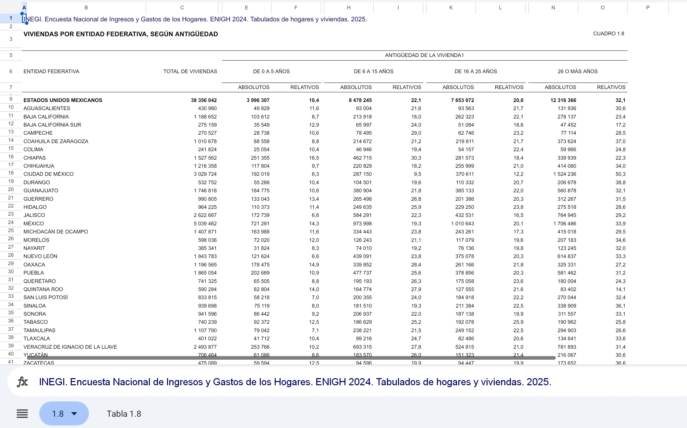
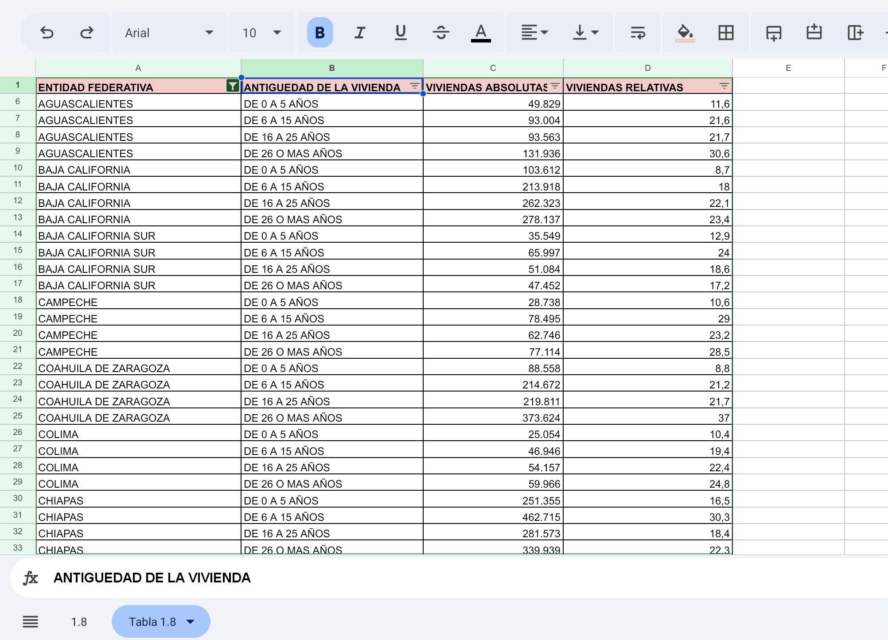

📊 INEGI. National Household Income and Expenditure Survey. ENIGH 2024. Tables by Federal Entity. 2025.

Table 1.8 – DWELLINGS BY FEDERAL ENTITY, ACCORDING TO AGE

* Authors: [Claudia Xochipa Vázquez]
* Processed Data Source: 🔗 [View Processed Google Sheet](https://docs.google.com/spreadsheets/d/1qGU4MyeRJ53I8XzL49EeprQG_uSkeksJDwzEtUyxOOg/edit?usp=drivesdk).
* Interactive Dashboard: 📊 [View Looker Studio Report](https://datastudio.google.com/reporting/2c1b8b97-9d14-4e0d-8191-1487f23621e1).

🛠️ Step-by-Step Data Pipeline & Analytical Process

1. INEGI Source Table Selection:

- Downloaded raw data table:

"INEGI Table 1.8 – Dwellings by Federal Entity, According to Age" Original Data Source: [INEGI – ENIGH 2024](https://www.inegi.org.mx/programas/enigh/nc/2024/).

.

2. Variable Identification (Dimensions vs. Metrics):

- "Federal Entity" (Entidad Federativa):
  Geographic dimension representing the 32 federal entities of Mexico.

- "Dwelling Age" (Antigüedad de la Vivienda):
  Categorical variable classifying dwellings into four age ranges: 0 to 5 years, 6 to 15 years, 16 to 25 years, and 26 years or more.

- "Absolute Dwellings" (Viviendas Absolutas):
  Numerical metric representing the total number of dwellings in each federal entity and age category.

- "Relative Dwellings" (Viviendas Relativas):
  Numerical metric representing the percentage of dwellings corresponding to each age category within each federal entity.

3. Tidy Data Transformation:

- Reshaped and unpivoted the original matrix table into a normalized flat structure (Tidy Data) in Google Sheets. The original age categories and their absolute and relative values were reorganized into four columns: "Federal Entity", "Dwelling Age", "Absolute Dwellings", and "Relative Dwellings".

Normalized Dataset Preview:

.

4. BI Connection:

- Connected the processed Google Sheet directly to Looker Studio as a data source, configuring "Federal Entity" and "Dwelling Age" as dimensions, and "Absolute Dwellings" and "Relative Dwellings" as metrics. The numerical fields were configured with appropriate aggregation settings to support comparisons and avoid incorrect totals.

5. Dashboard Design & Interactive Visuals:

- Built an interactive dashboard featuring a main KPI scorecard displaying the national total of 32,443,990 dwellings, a geographic map showing the concentration of dwellings by federal entity, a pie chart representing the national composition of dwellings according to age, and a stacked bar chart comparing the age distribution across the 32 federal entities.

- Also included a detailed numerical table showing absolute and relative values by state and dwelling age, along with dynamic filters for "Dwelling Age" and "Federal Entity".

Final Dashboard Preview:

"Dashboard Screenshot" (docs/screenshots/Cuadro_1_8_Viviendas_por_antiguedad_dashboard.jpg)
