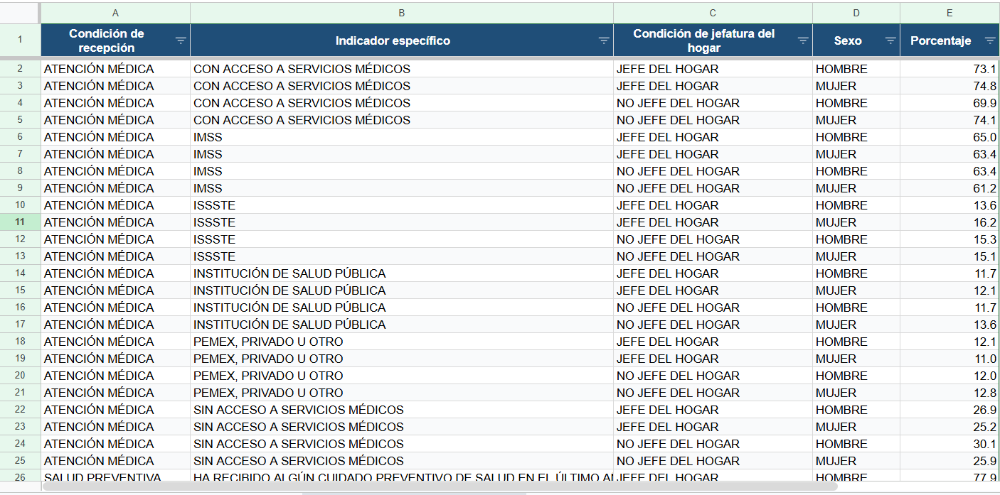
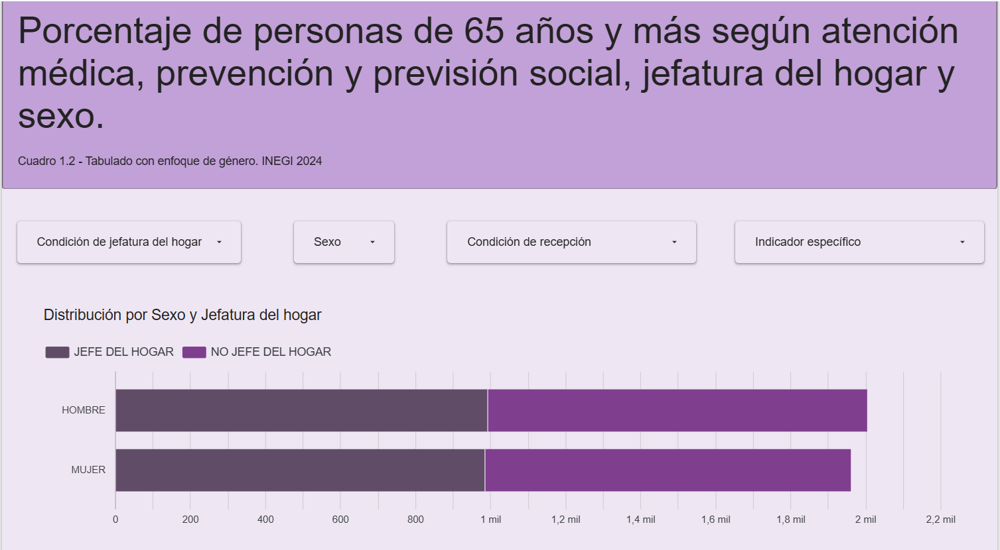

### 📊 INEGI. Encuesta Nacional de Ingresos y Gastos de los Hogares. ENIGH 2024. Tabulados por entidad federativa. 2025.
Cuadro 1.2 - PORCENTAJE DE INTEGRANTES DEL HOGAR DE 65 AÑOS Y MÁS QUE RECIBEN ATENCIÓN MÉDICA, SALUD PREVENTIVA Y PREVISIÓN SOCIAL SEGÚN PARENTESCO Y SEXO
- **Authors:** Israel Ochoa Ordoñez
- **Processed Data Source:** 🔗 [View Processed Google Sheet](https://docs.google.com/spreadsheets/d/1ixzMPVw9_2EmSIm-OYm-G_u8ISN98sIj_-YzZOFMHPs/edit?usp=sharing)
- **Interactive Dashboard:** 📊 [View Looker Studio Report](https://datastudio.google.com/reporting/384b4750-b9fb-4bfd-9786-fb8a1576442e)

#### 🛠️ Step-by-Step Data Pipeline & Analytical Process

1. **INEGI Source Table Selection:**
  - Downloaded raw data table: 

2. **Variable Identification (Dimensions vs. Metrics):**
- **`Reception Status` (*Condición de recepción*):**
     *Categorical dimension indicating whether household members aged 65 and over receive the specified health or social security benefit.*

- **`Specific Indicator` (*Indicador específico*):**
     *Categorical dimension classifying the type of service or benefit received (medical care, preventive health, or social security).*

- **`Household Headship Status` (*Condición de jefatura del hogar*):**
     *Demographic dimension identifying the kinship or household headship role of the individual.*

- **`Sex` (*Sexo*):**
     *Demographic breakdown identifying male (*Hombres*) and female (*Mujeres*) population shares.*

- **`Percentage` (*Porcentaje* - Metric):**
     *The unique numerical field representing the percentage of household members aged 65 and over in each category.*

3. **Tidy Data Transformation:**
- Reshaped and unpivoted the original matrix table into a normalized flat structure (*Tidy Data*) in Google Sheets, removing header overlays and total/subtotal rows to avoid double-counting.
   
   ##### Normalized Dataset Preview:
   

4. **BI Connection:**
- Connected the processed Google Sheet directly to Looker Studio as a live data source, validating metric aggregation settings (ensuring `Percentage` is properly configured).

5. **Dashboard Design & Interactive Visuals:**
- Built an interactive dashboard featuring key metrics (KPI scorecards), breakdown charts, explanatory descriptions, and dynamic slicers/filters for `Reception Status`, `Specific Indicator`, `Household Headship Status`, and `Sex`.

   ##### Final Dashboard Preview:
   
