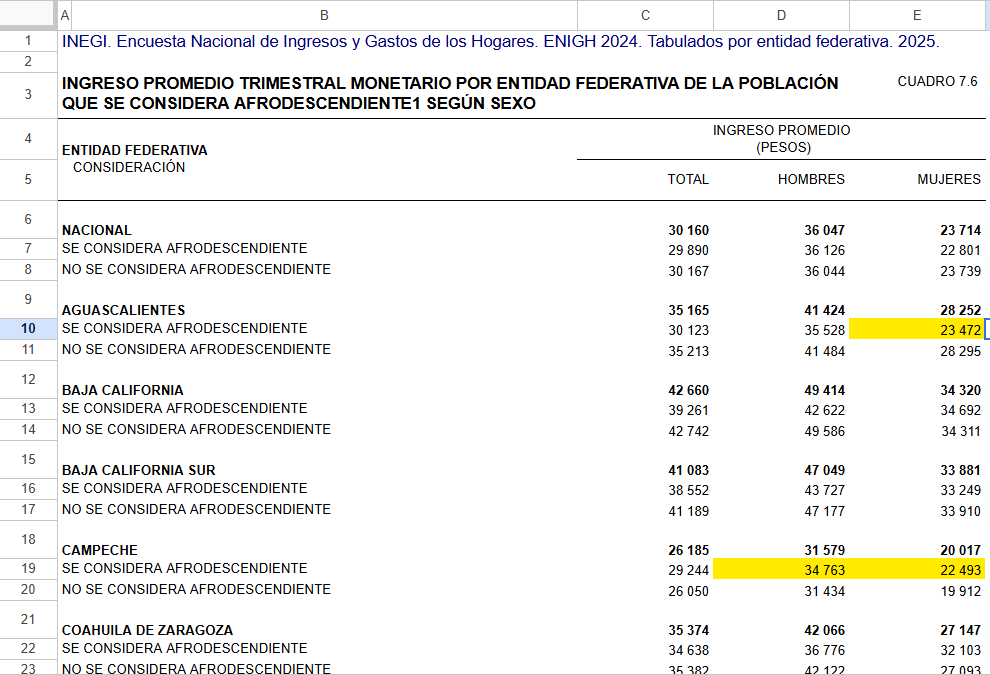
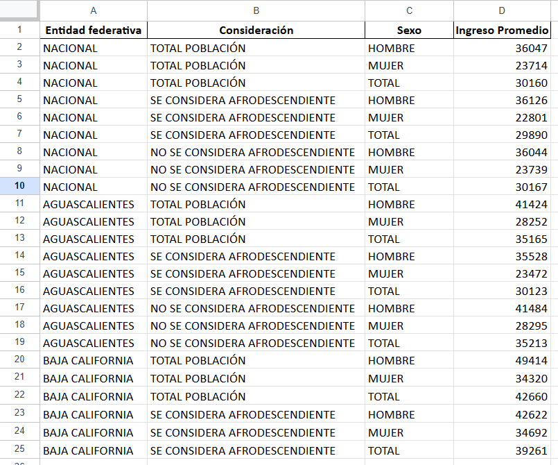
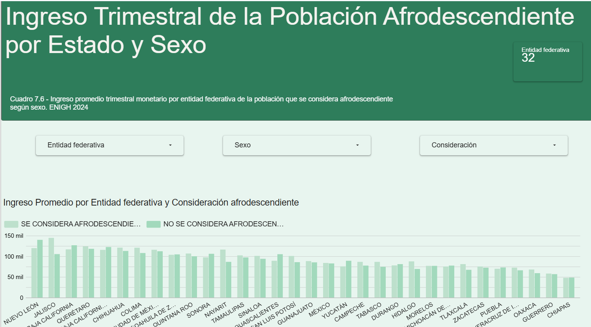

### 📊 INEGI. Encuesta Nacional de Ingresos y Gastos de los Hogares. ENIGH 2024. Tabulados por entidad federativa. 2025.
Cuadro 7.6 - INGRESO PROMEDIO TRIMESTRAL MONETARIO POR ENTIDAD FEDERATIVA DE LA POBLACIÓN QUE SE CONSIDERA AFRODESCENDIENTE SEGÚN SEXO
- **Authors:** Israel Ochoa Ordoñez
- **Processed Data Source:** 🔗 [View Processed Google Sheet](https://docs.google.com/spreadsheets/d/1oz3jdjPKa1_Yxzm-BTuwYQUBmE-aOXQzFeydLI2IFkY/edit?usp=sharing)
- **Interactive Dashboard:** 📊 [View Looker Studio Report](https://datastudio.google.com/reporting/7055cb6e-b2d8-4b28-ab3a-876eafc726ee)

#### 🛠️ Step-by-Step Data Pipeline & Analytical Process

1. **INEGI Source Table Selection:**
  - Downloaded raw data table: 

2. **Variable Identification (Dimensions vs. Metrics):**
- **`State` (*Entidad Federativa*):**
     *Geographic dimension representing the 32 federal entities/states of Mexico.*

- **`Self-Identifies as Afro-descendant` (*Se considera afrodescendiente*):**
     *Demographic dimension identifying the population segment that self-identifies as Afro-descendant.*

- **`Does Not Self-Identify as Afro-descendant` (*No se considera afrodescendiente*):**
     *Demographic dimension identifying the population segment that does not self-identify as Afro-descendant.*

- **`Sex` (*Sexo*):**
     *Demographic breakdown identifying male (*Hombres*) and female (*Mujeres*) population groups.*

- **`Average Income` (*Ingreso Promedio* - Metric):**
     *The unique numerical field representing the quarterly average monetary income in Mexican pesos.*

3. **Tidy Data Transformation:**
- Reshaped and unpivoted the original matrix table into a normalized flat structure (*Tidy Data*) in Google Sheets, removing header overlays and total/subtotal rows to avoid double-counting.
   
   ##### Normalized Dataset Preview:
   

4. **BI Connection:**
- Connected the processed Google Sheet directly to Looker Studio as a live data source, validating metric aggregation settings (ensuring `Average Income` is properly configured).

5. **Dashboard Design & Interactive Visuals:**
- Built an interactive dashboard featuring key metrics (KPI scorecards), breakdown charts, explanatory descriptions, and dynamic slicers/filters for `State`, `Self-Identifies as Afro-descendant`, `Does Not Self-Identify as Afro-descendant`, and `Sex`.

   ##### Final Dashboard Preview:
   
