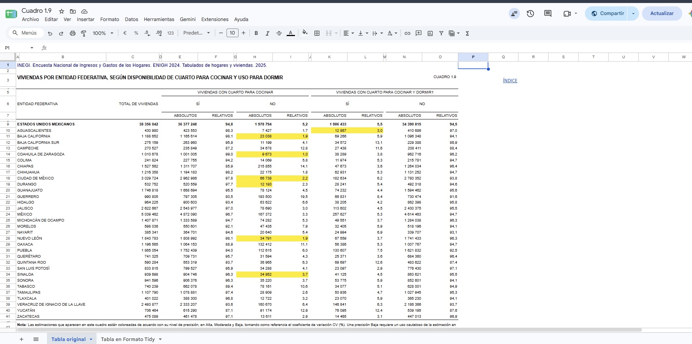
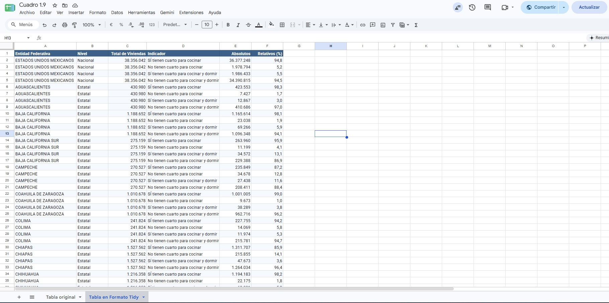
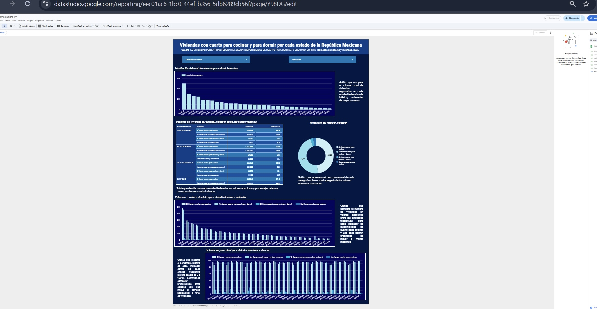

### 📊 INEGI. Encuesta Nacional de Ingresos y Gastos de los Hogares. ENIGH 2024. Tabulados de hogares y viviendas. 2025.
Cuadro 1.9 - VIVIENDAS POR ENTIDAD FEDERATIVA, SEGÚN DISPONIBILIDAD DE CUARTO PARA COCINAR Y USO PARA DORMIR

- **Author:** Evelyn Duarte Romero
- **Processed Data Source:** 🔗 [View Processed Google Sheet](https://docs.google.com/spreadsheets/d/1TkVmvcp8yllfppcdID8IXYAHOvsE87L0Sly7lVHG9Jk/edit?usp=sharing)
- **Interactive Dashboard:** 📊 [View Looker Studio Report](https://datastudio.google.com/reporting/eec01ac6-1bc0-44ef-b356-5db6289cb56f)

#### 🛠️ Step-by-Step Data Pipeline & Analytical Process

1. **INEGI Source Table Selection:**
   - Downloaded the raw statistical table from INEGI (ENIGH 2024, Table 1.9), detailing total dwellings by federal entity according to kitchen room availability and whether the kitchen is also used for sleeping:
   

2. **Variable Identification (Dimensions vs. Metrics):**
   - **`State` (*Entidad Federativa* - Qualitative / Nominal Dimension):**
     *Geographic dimension representing the 32 federal entities/states of Mexico, plus the national reference (`ESTADOS UNIDOS MEXICANOS`).*

   - **`Geographic Level` (*Nivel* - Qualitative / Nominal Dimension):**
     *Hierarchical classification distinguishing national aggregate records (`Nacional`) from state-level records (`Estatal`) to filter accurately without double-counting.*

   - **`Housing Indicator` (*Indicador* - Qualitative / Nominal Dimension):**
     *Categorical breakdown identifying four housing conditions: dwellings with a kitchen room (`SÍ tienen cuarto para cocinar`), dwellings without a kitchen room (`No tienen cuarto para cocinar`), dwellings where the kitchen is also used for sleeping (`Sí tienen cuarto para cocinar y dormir`), and dwellings where the kitchen is not used for sleeping (`No tienen cuarto para cocinar y dormir`).*

   - **`Total Dwellings` (*Total de Viviendas* - Quantitative / Discrete Metric):**
     *Numerical field representing the total count of inhabited dwellings in each federal entity.*

   - **`Absolute Count` (*Absolutos* - Quantitative / Discrete Metric):**
     *Numerical field counting the exact number of dwellings meeting each specific kitchen availability and sleeping-use condition.*

   - **`Relative Percentage` (*Relativos (%)* - Quantitative / Continuous Metric):**
     *Percentage share representing the proportion of dwellings under each housing indicator relative to its reference group.*

3. **Tidy Data Transformation:**
   - Reshaped and unpivoted the original wide matrix into a normalized flat structure (*Tidy Data*) in Google Sheets (`Tabla en Formato Tidy`), removing multi-level merged headers and separating `Nivel` (`Nacional` vs. `Estatal`) so BI filters aggregate state figures cleanly.

   ##### Normalized Dataset Preview:
   

4. **BI Connection:**
   - Connected the `Tabla en Formato Tidy` worksheet from Google Sheets directly to Looker Studio as a live data source, validating field data types (geographic/text for dimensions and numeric/percentage for metrics) and configuring appropriate aggregation settings (`SUM` and `AVERAGE`).

5. **Dashboard Design & Interactive Visuals:**
   - Built an interactive Looker Studio dashboard featuring KPI scorecards, comparative state and indicator charts, analytical descriptions, and dynamic dropdown filters/slicers for `Entidad Federativa`, `Nivel`, and `Indicador`.

   ##### Final Dashboard Preview:
   
