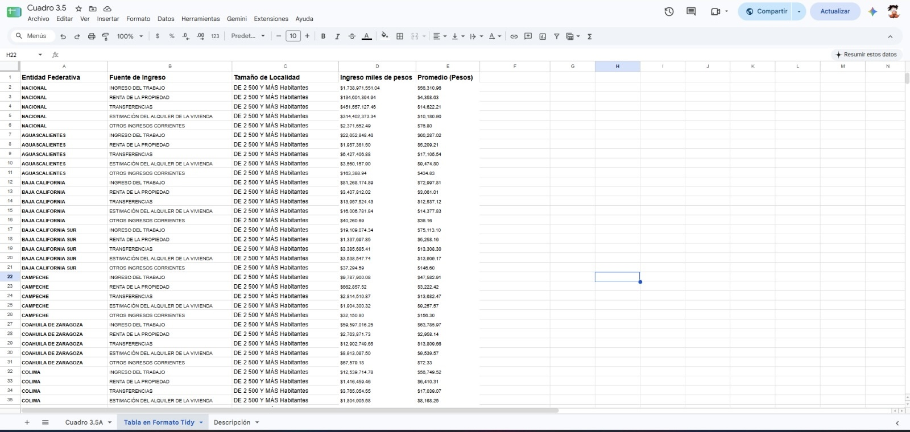
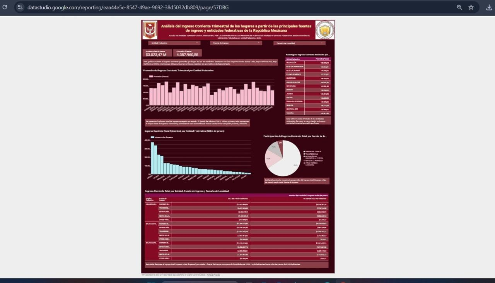

### 📊 INEGI. Encuesta Nacional de Ingresos y Gastos de los Hogares. ENIGH 2024. Tabulados por entidad federativa. 2025.
Cuadro 3.5A - INGRESO CORRIENTE TOTAL TRIMESTRAL POR LA COMPOSICIÓN DE LAS PRINCIPALES FUENTES DE INGRESO Y ENTIDAD FEDERATIVA SEGÚN TAMAÑO DE LOCALIDAD

- **Author:** Evelyn Duarte Romero
- **Processed Data Source:** 🔗 [View Processed Google Sheet](https://docs.google.com/spreadsheets/d/1fJLlM8gosNYPMN_S12WZN5McQfsXtALr7KBM44_NL9c/edit?usp=sharing)
- **Interactive Dashboard:** 📊 [View Looker Studio Report](https://datastudio.google.com/reporting/eaa44e5e-8547-49ae-9692-38d5032db809)

#### 🛠️ Step-by-Step Data Pipeline & Analytical Process

1. **INEGI Source Table Selection:**
   - Downloaded the raw statistical table from INEGI (ENIGH 2024, Table 3.5A), which details quarterly total current income by main income sources, federal entity, and locality size:
   

2. **Variable Identification (Dimensions vs. Metrics):**
   - **`State` (*Entidad Federativa* - Qualitative / Nominal Dimension):**
     *Geographic dimension representing the 32 federal entities/states of Mexico (plus the national aggregate reference).*

   - **`Income Source` (*Fuente de Ingreso* - Qualitative / Nominal Dimension):**
     *Categorical breakdown classifying quarterly household income into five main components: Labor Income (`INGRESO DEL TRABAJO`), Property Rent (`RENTA DE LA PROPIEDAD`), Transfers (`TRANSFERENCIAS`), Imputed Housing Rent (`ESTIMACIÓN DEL ALQUILER DE LA VIVIENDA`), and Other Current Income (`OTROS INGRESOS CORRIENTES`).*

   - **`Locality Size` (*Tamaño de Localidad* - Qualitative / Ordinal Dimension):**
     *Geographic classification separating urban areas (`DE 2 500 Y MÁS Habitantes` — 2,500 or more inhabitants) from rural areas (`DE MENOS DE 2 500 Habitantes` — fewer than 2,500 inhabitants).*

   - **`Quarterly Income` (*Ingreso en miles de pesos* - Quantitative / Continuous Metric):**
     *Numerical field measuring the total quarterly current income in thousands of Mexican pesos for each combination of state, income source, and locality size.*

   - **`Average Quarterly Income` (*Promedio en pesos* - Quantitative / Continuous Metric):**
     *Numerical field representing the average quarterly income per household in Mexican pesos.*

3. **Tidy Data Transformation:**
   - Reshaped and unpivoted the original cross-tabulated matrix into a normalized flat structure (*Tidy Data*) in Google Sheets (`Tabla en Formato Tidy`), eliminating merged headers, multi-level column groupings, and summary/subtotal rows to prevent double-counting in BI aggregations.

   ##### Normalized Dataset Preview:
   

4. **BI Connection:**
   - Connected the normalized `Tabla en Formato Tidy` tab from Google Sheets directly to Looker Studio as a live data source, verifying field data types (text/geographic for dimensions and currency/numeric for metrics) and configuring proper aggregation rules (`SUM` for total income and `AVERAGE` for average household income).

5. **Dashboard Design & Interactive Visuals:**
   - Built an interactive Looker Studio dashboard featuring KPI scorecards, comparative bar/breakdown charts by income source and state, descriptive analytical text blocks, and dynamic dropdown filters/slicers for `Entidad Federativa`, `Fuente de Ingreso`, and `Tamaño de Localidad`.

   ##### Final Dashboard Preview:
   
