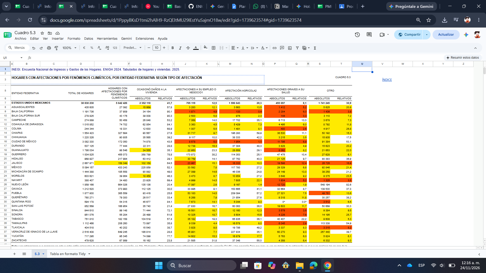
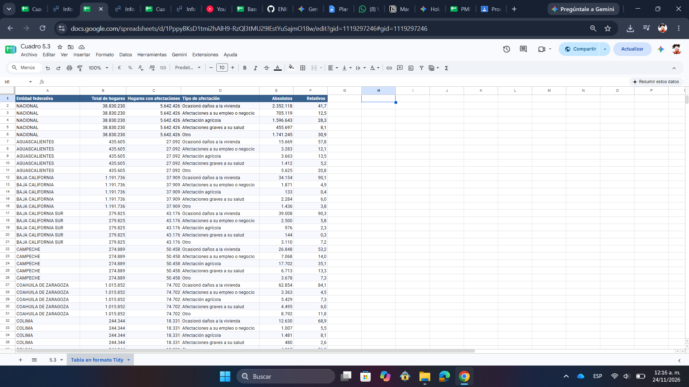
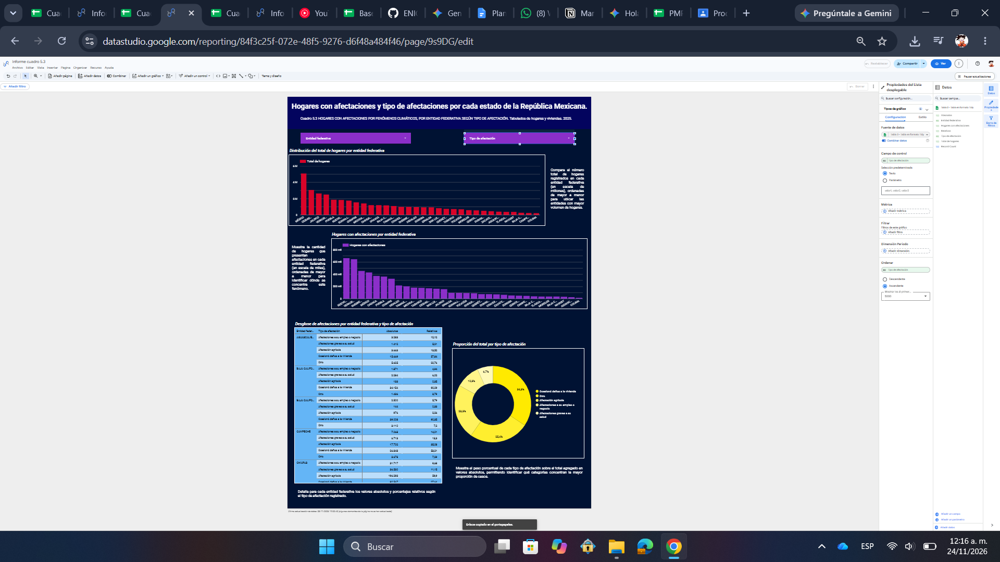

### 📊 INEGI. Encuesta Nacional de Ingresos y Gastos de los Hogares. ENIGH 2024. Tabulados de hogares y viviendas. 2025.
Cuadro 5.3 - HOGARES CON AFECTACIONES POR FENÓMENOS CLIMÁTICOS, POR ENTIDAD FEDERATIVA SEGÚN TIPO DE AFECTACIÓN

- **Author:** Evelyn Duarte Romero
- **Processed Data Source:** 🔗 [View Processed Google Sheet](https://docs.google.com/spreadsheets/d/1PppyBKsD1tmi2hAlH9-RzQl3tMU29IEstYuSajmO18w/edit?usp=sharing)
- **Interactive Dashboard:** 📊 [View Looker Studio Report](https://datastudio.google.com/reporting/84f3c25f-072e-48f5-9276-d6f48a484f46)

#### 🛠️ Step-by-Step Data Pipeline & Analytical Process

1. **INEGI Source Table Selection:**
   - Downloaded the raw statistical table from INEGI (ENIGH 2024, Table 5.3), which presents the number of households affected by climate phenomena across Mexican federal entities broken down by the type of impact suffered:
   

2. **Variable Identification (Dimensions vs. Metrics):**
   - **`State` (*Entidad federativa* - Qualitative / Nominal Dimension):**
     *Geographic dimension representing the 32 federal entities/states of Mexico, plus the national reference (`NACIONAL`).*

   - **`Type of Impact` (*Tipo de afectación* - Qualitative / Nominal Dimension):**
     *Categorical breakdown classifying the five types of climate-related impacts reported by households: Housing Damage (`Ocasionó daños a la vivienda`), Employment or Business Impact (`Afectaciones a su empleo o negocio`), Agricultural Impact (`Afectación agrícola`), Severe Health Impact (`Afectaciones graves a su salud`), and Other (`Otro`).*

   - **`Total Households` (*Total de hogares* - Quantitative / Discrete Metric):**
     *Numerical field indicating the total number of households in each federal entity.*

   - **`Affected Households` (*Hogares con afectaciones* - Quantitative / Discrete Metric):**
     *Numerical field representing the total number of households that experienced at least one climate-related impact.*

   - **`Absolute Count` (*Absolutos* - Quantitative / Discrete Metric):**
     *Numerical field measuring the exact count of affected households for each specific type of impact.*

   - **`Relative Percentage` (*Relativos* - Quantitative / Continuous Metric):**
     *Percentage share representing the proportion of affected households experiencing each type of impact within a given state.*

3. **Tidy Data Transformation:**
   - Reshaped and unpivoted the original wide matrix into a normalized flat structure (*Tidy Data*) in Google Sheets (`Tabla en formato Tidy`), removing merged multi-level headers and organizing each combination of state and impact type into a single row for clean BI querying.

   ##### Normalized Dataset Preview:
   

4. **BI Connection:**
   - Connected the `Tabla en formato Tidy` worksheet from Google Sheets directly to Looker Studio as a live data source, validating field data types (geographic/text for dimensions and numeric/percentage for metrics) and configuring appropriate aggregation rules (`SUM` and `AVERAGE`).

5. **Dashboard Design & Interactive Visuals:**
   - Built an interactive Looker Studio dashboard featuring KPI scorecards, comparative state and impact-type charts, descriptive analytical notes, and dynamic dropdown filters/slicers for `Entidad federativa` and `Tipo de afectación`.

   ##### Final Dashboard Preview:
   
