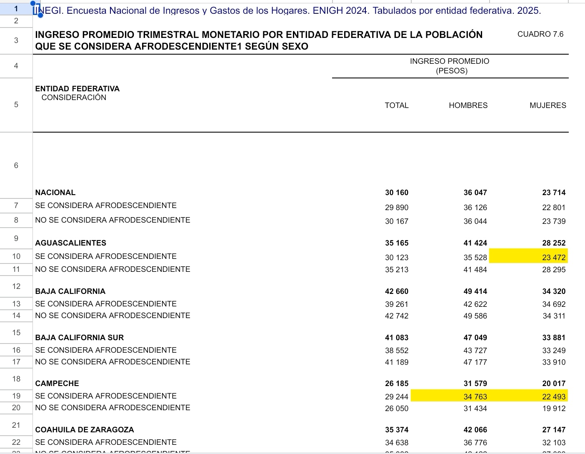
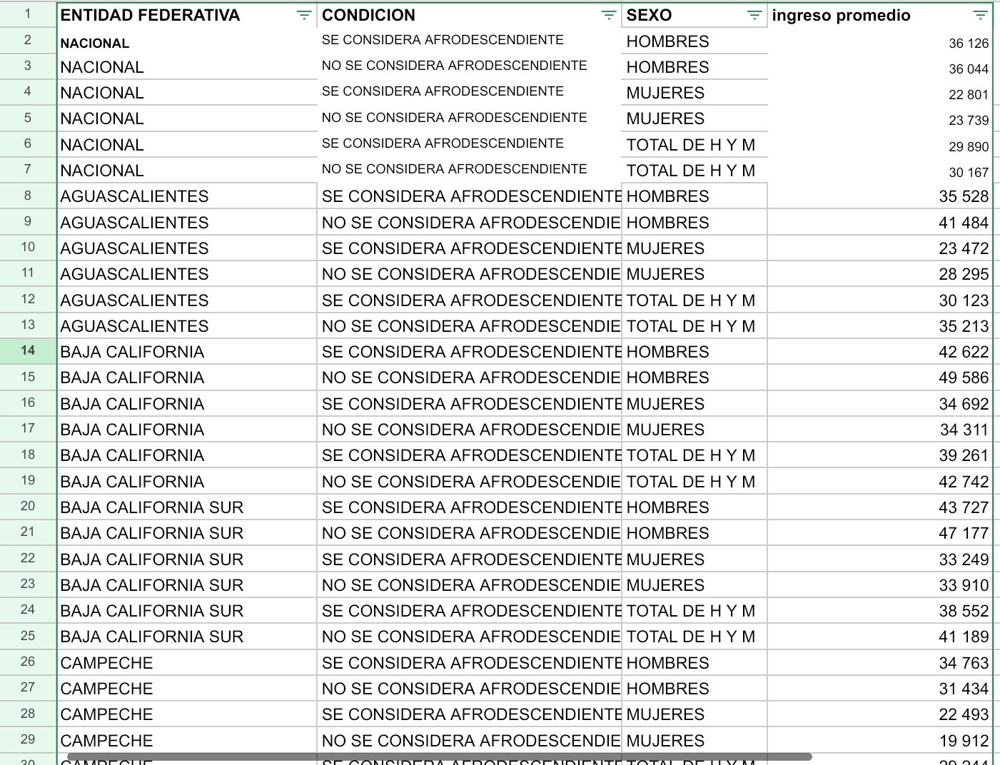
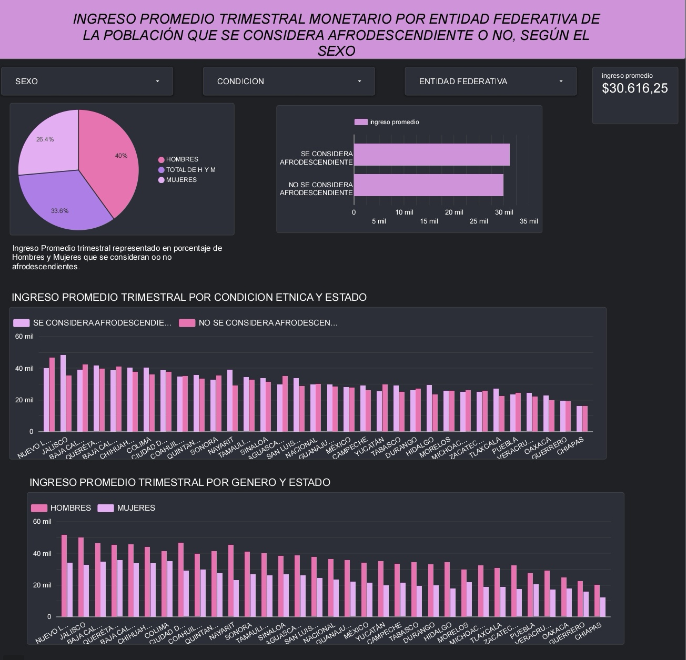

📊 INEGI National Household Income and Expenditure Survey (ENIGH) 2024. Tables by Federal Entity. 2025.

Table 7.6 – QUARTERLY MONETARY AVERAGE INCOME BY FEDERAL ENTITY OF THE POPULATION THAT CONSIDERS ITSELF AFRO-DESCENDANT OR NOT, ACCORDING TO SEX.

* Authors: [Claudia Xochipa Vazquez]
* Processed Data Source: 🔗 [View Processed Google Sheet](https://docs.google.com/spreadsheets/d/1qVIgIN19VPug9szwohLLFh7YGfEVZxcAS5ZWFuNwciU/edit?usp=sharing).
* Interactive Dashboard: 📊 [View Looker Studio Report](https://datastudio.google.com/reporting/f3416fb9-ba87-48d8-8684-b4793a0c4e56).

🛠️ Step-by-Step Data Pipeline & Analytical Process

1. INEGI Source Table Selection:

* Selected the original data table from the National Institute of Statistics and Geography (INEGI), specifically Table 7.6, from the National Household Income and Expenditure Survey (ENIGH) 2024.
* The table presents quarterly average monetary income by federal entity of the population that considers itself Afro-descendant or not, according to sex.
* Original Data Source: [INEGI – ENIGH 2024](https://www.inegi.org.mx/programas/enigh/nc/2024/).

.

2. Variable Identification (Dimensions vs. Metrics):

* "Federal Entity" (Entidad Federativa):
  
  * Qualitative (Nominal). Represents the federal entities of Mexico, including the national-level data.

* "Afro-descendant Status" (Condición de Afrodescendencia):
  
  * Qualitative (Nominal). Identifies whether the population considers itself Afro-descendant or not.

* "Sex" (Sexo):
  
  * Qualitative (Nominal). Classifies the information into men, women, and total men and women.
  
* "Average Income" (Ingreso Promedio):
  
  * Quantitative. Represents the quarterly average monetary income, measured in Mexican pesos, for each demographic category.

3. Tidy Data Transformation:

* Transformed the original dataset from a wide format into a long format (Tidy Data).
*  Separated the original income columns (Total, Men, and Women) into individual records under a single variable called Sex.
* Organized the information into four variables: Federal Entity, Afro-descendant Status, Sex, and Average Income.
* This transformation created a structured dataset that facilitates filtering, comparison, and visualization in Business Intelligence tools.

Normalized Dataset Preview:

4. BI Connection:

* Connected the processed Google Sheets document to Looker Studio as a data source.
* Used the four variables to organize and configure the dashboard.
* Identified Federal Entity, Afro-descendant Status, and Sex as dimensions, while Average Income was used as the numerical metric.
* Configured the metric to allow comparisons of average income across the different demographic categories and federal entities.

5. Dashboard Design & Interactive Visuals:

* Developed an interactive dashboard in Looker Studio to analyze quarterly average monetary income across the federal entities of Mexico.
* Incorporated different graphical visualizations to represent and compare income levels.
* The dashboard allows users to explore differences according to federal entity, Afro-descendant status, and sex.
* These visualizations facilitate the analysis of income distribution and comparisons between demographic groups.

Final Dashboard Preview:

.
