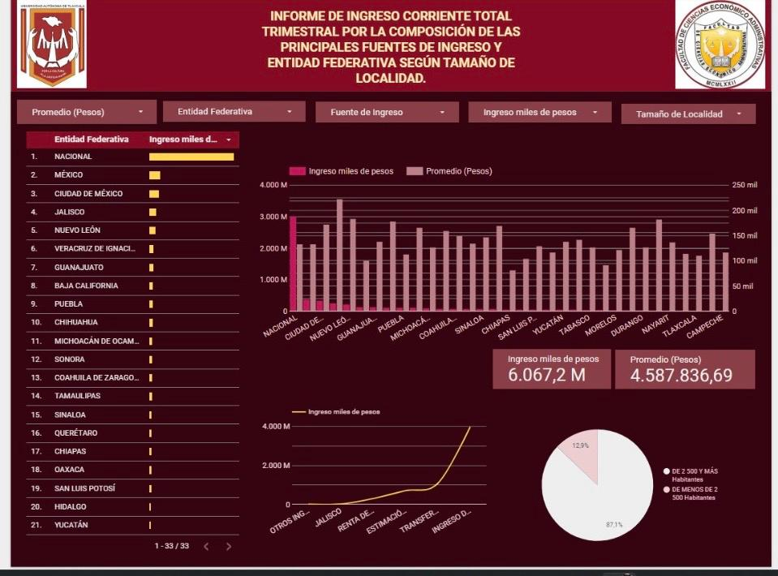

### 📊 INEGI. Encuesta Nacional de Ingresos y Gastos de los Hogares. ENIGH 2024. Tabulados por entidad federativa. 2025.
Cuadro 3.5 A - INGRESOS Y GASTOS EN LOS HOGARES POR ENTIDAD FEDERATIVA
- **Author:** Evelyn Duarte Romero
- **Processed Data Source:** 🔗 [View Processed Google Sheet](https://docs.google.com/spreadsheets/d/1fJLlM8gosNYPMN_S12WZN5McQfsXtALr7KBM44_NL9c/edit?usp=sharing)
- **Interactive Dashboard:** 📊 [View Looker Studio Report](https://datastudio.google.com/s/hUGm9RuBO0s)

#### 🛠️ Step-by-Step Data Pipeline & Analytical Process

1. **INEGI Source Table Selection:**
   * Downloaded raw data table corresponding to **ENIGH 2024 Table 3.5 A** from INEGI.
   * *Original Table Reference:* `docs/screenshots/Cuadro_3_5_A_original_table.png`

2. **Variable Identification (Dimensions vs. Metrics):**
   * **Dimensions:** Identified categorical fields such as geographic entity/state (`State`), income/expense categories (`Category`), and demographic breakdowns.
   * **Metrics:** Identified numerical fields representing financial figures, monetary totals, and household volume metrics.

3. **Tidy Data Transformation:**
   * Reshaped and unpivoted the complex matrix table into a normalized flat structure (*Tidy Data*) in Google Sheets.
   * Removed header overlays, empty padding rows, and summary totals/subtotals to eliminate risk of double-counting in business intelligence aggregations.
   * *Normalized Dataset Reference:*  ![Tidy Data]
   (Cuadro_3_5A_INGRESO_CORRIENTE_POR_LA_COMPOSICIÓN_DE_LAS_PRINCIPALES_FUENTES_DE_INGRESO_TIDY_FORMAT_TABLE.png)

4. **BI Connection:**
   * Connected the processed Google Sheet directly to Looker Studio as a dynamic live data source.
   * Validated data types, schema definitions, and aggregation properties across dimensions and numerical fields.

5. **Dashboard Design & Interactive Visuals:**
   * Designed and structured the interactive dashboard layout.
   * Built analytical visualizations, summary KPI scorecards, descriptive notes, and dynamic control filters for exploratory data analysis.
   * *Final Dashboard Reference:* 
