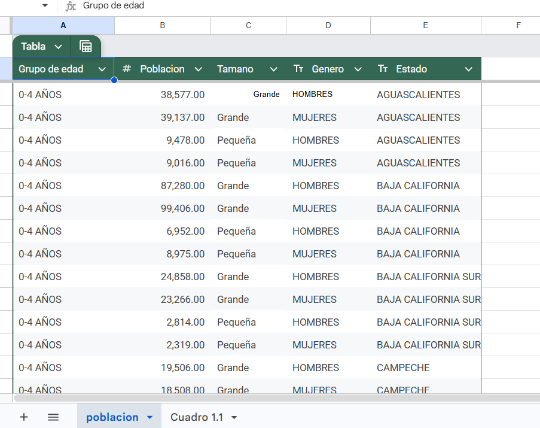
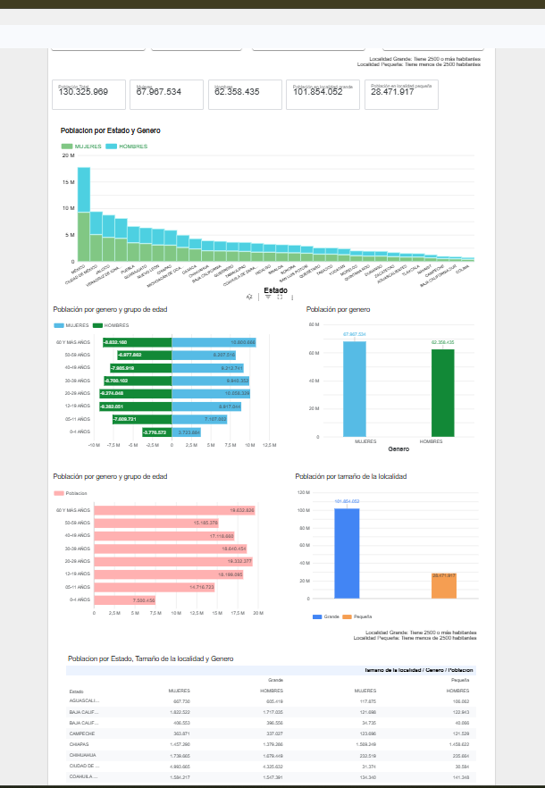

### 📊 INEGI. Encuesta Nacional de Ingresos y Gastos de los Hogares. ENIGH 2024. Tabulados por entidad federativa. 2025.
Cuadro 1.1 - POBLACIÓN TOTAL POR GRUPOS DE EDAD Y ENTIDAD FEDERATIVA SEGÚN SEXO Y TAMAÑO DE LOCALIDAD
* **Autors:** Yamileth Garcia Hernandez / Servio Edoardo Lima Fragoso 
* **Processed Data Source:** 🔗 [View Processed Google Sheet](https://docs.google.com/spreadsheets/d/1KiwOJfW-92jXsD7RPhwJFm3Jjw-ttWELdDIVnFCa8gE/edit?gid=812402253#gid=812402253)
* **Interactive Dashboard:** 📊 [View Looker Studio Report](https://datastudio.google.com/reporting/4b5097c9-4285-4b60-828d-41a31d5301f1/page/1X59F)

#### 🛠️ Step-by-Step Data Pipeline & Analytical Process

1. **INEGI Source Table Selection:**
   * Downloaded raw data table: 

2. **Variable Identification (Dimensions vs. Metrics):**
   * **`Age Group` (*Grupo de Edad*):**
     *Categorical ranges dividing the population into 5-year age brackets (0-4, 5-11, 12-19, 20-29, 30-39,... up to 60+).*

   * **`Locality Size` (*Tamaño de Localidad*):**
     *Geographic classification separating urban areas (≥ 2,500 inhabitants) from rural areas (< 2,500 inhabitants).*

   * **`Gender` (*Género*):**
     *Demographic breakdown identifying male (*Hombres*) and female (*Mujeres*) population counts.*

   * **`State` (*Entidad Federativa*):**
     *Geographic dimension representing the 32 federal entities/states of Mexico.*

   * **`Population` (*Población* - Metric):**
     *The unique numerical field counting the total number of individuals in each demographic group.*
3. **Tidy Data Transformation:**
   * Reshaped and unpivoted the original matrix table into a normalized flat structure (*Tidy Data*) in Google Sheets, removing header overlays and total/subtotal rows to avoid double-counting.
   
   ##### Normalized Dataset Preview:
   

4. **BI Connection:**
   * Connected the processed Google Sheet directly to Looker Studio as a live data source, validating metric aggregation settings (ensuring `Population` is set to `SUM`).

5. **Dashboard Design & Interactive Visuals:**
   * Built an interactive dashboard featuring key metrics (KPI scorecards), breakdown charts, and dynamic slicers/filters for `State`, `Gender`, and `Locality Size`.

   ##### Final Dashboard Preview:
   
